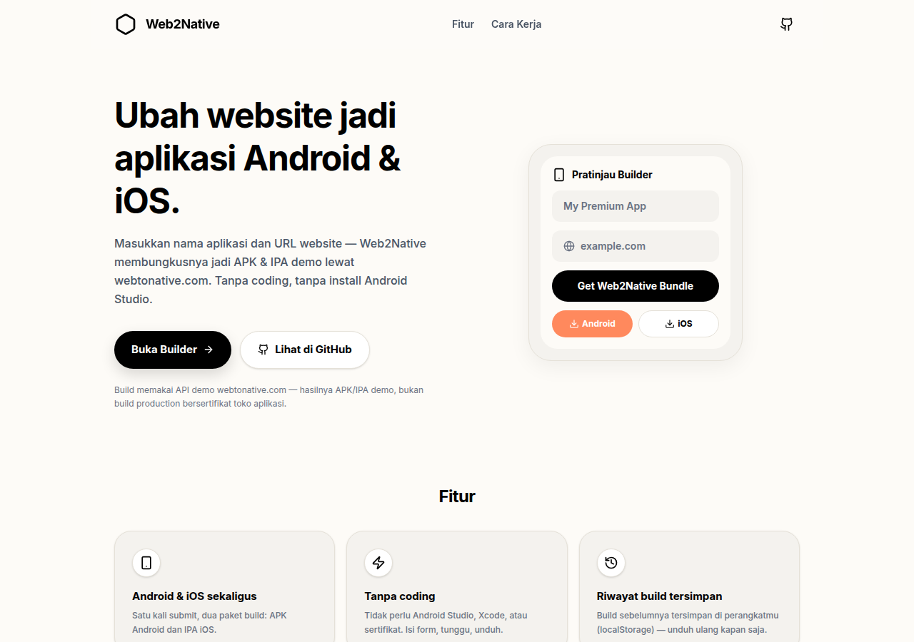

# Web2Native

Ubah website jadi aplikasi Android & iOS. Masukkan nama aplikasi dan URL website — Web2Native membungkusnya jadi APK & IPA. Tanpa coding, tanpa Android Studio.

## 🌐 Live Demo

**https://web2native.pages.dev**

[](https://web2native.pages.dev)

[](docs/demo/demo.mp4)

> Video demo direkam headless (tanpa suara).

## ✨ Fitur

- **Android & iOS sekaligus** — satu kali submit, dua paket build: APK Android dan IPA iOS.
- **Tanpa coding** — isi form, tunggu, unduh.
- **Status build live** — progress Android dan iOS dipantau tiap 5 detik sampai keduanya DONE.
- **Riwayat build** — build sebelumnya tersimpan di perangkat (localStorage), bisa diunduh ulang.
- **Rate limit 1/hari** — satu build per 24 jam per perangkat (localStorage), supaya layanan demo tidak di-spam.
- **Landing SaaS** — kunjungan pertama melihat landing; kunjungan berikut langsung masuk builder.

## ⚠️ Jujur soal cara kerja

Web2Native **tidak meng-compile aplikasi sendiri**. Build dikerjakan oleh **webtonative.com** lewat API demo publik mereka (`https://www.webtonative.com/api/v1`):

1. `POST /api/build` → `POST /build-app-request` ke webtonative.com (butuh `WEBTONATIVE_EMAIL`).
2. Frontend polling `GET /api/status?requestId=…` tiap 5 detik.
3. Begitu file APK/IPA tersedia di S3 webtonative, status jadi DONE dan tombol unduh muncul.

Hasilnya adalah **APK/IPA demo** — bukan build production bersertifikat toko aplikasi. Situs yang dibungkus harus valid dan bisa diakses publik (contoh: `example.com` ditolak validator upstream dengan `WEBSITE_URL_INVALID`).

Dua bug nyata yang diperbaiki di v1.1.0:

- **Route `/api/build` tidak pernah ada** — frontend memanggilnya, Next.js menjawab 404, jadi tidak ada build yang bisa dimulai. Sekarang ada (di Pages Worker).
- **Status tidak pernah jadi DONE** — kode lama membaca `android_status`/`ios_status` dari respons `check-app-status` upstream, padahal upstream tidak pernah mengembalikan field itu (hanya flag ketersediaan server). Akibatnya UI polling selamanya padahal APK sudah jadi. Sekarang DONE diturunkan dari ketersediaan URL download (HEAD → 3xx = DONE). Terverifikasi: APK 9,8 MB terunduh dan dikenali sebagai Android package.

## 🏗️ Arsitektur

Next.js 15 (App Router, static export) + Cloudflare Pages Worker:

```
Browser ──► Pages (static export out/)
              │  /api/build (POST), /api/status (GET)
              ▼
         worker/_worker.js ──► webtonative.com/api/v1
              │                    │ build-app-request
              │                    │ check-app-status + demo/download
              ▼                    ▼
         ASSETS binding      S3 (APK/IPA demo)
```

`output: 'export'` tidak bisa membawa route API dinamis (`next build` menolaknya) — jadi logika `/api/*` tinggal di `worker/_worker.js`, di-copy ke `out/_worker.js` saat build dan di-deploy sebagai `_worker.bundle`. Detail: [docs/architecture.md](docs/architecture.md), [docs/api.md](docs/api.md), [docs/deployment.md](docs/deployment.md).

## 🚀 Menjalankan lokal

```bash
# Install (butuh Node 20+)
npm install

# Build static export + worker
npm run build

# Jalankan lokal (server Node kecil yang meniru Pages: static + worker)
WEBTONATIVE_EMAIL=kamu@example.com npm run serve
# -> http://127.0.0.1:8329/
```

Tanpa `WEBTONATIVE_EMAIL`, `POST /api/build` menjawab 503 dengan pesan yang jelas.

## 🧪 Tes

```bash
npm run typecheck   # tsc --noEmit
npm run lint        # eslint
npm run test        # unit test worker (node --test, upstream di-mock)
npm run build       # next build (static export) + copy worker
```

Play-test headless (puppeteer, termasuk **build beneran** sampai DONE): `~/workspace/absensirapat-audit/diag/play-w2n.mjs` — 20/20 lolos, 0 console/page/request error.

## 📁 Struktur

```
app/                  # Next.js App Router (page.tsx = landing + builder)
worker/
  _worker.js          # Pages Worker: /api/build + /api/status + ASSETS
  _worker.test.mjs    # unit test worker (9 tes)
scripts/
  serve-worker.mjs    # server lokal peniru Pages
  smoke.mjs           # smoke test output statis
docs/
  architecture.md api.md deployment.md diagram.svg
  screenshots/        # screenshot asli dari play-test
  demo/demo.mp4       # video demo (tanpa suara)
```

## 📄 Lisensi

MIT — lihat [LICENSE](./LICENSE).

---
Dikembangkan oleh **dezzorigin** (Nabil Aulia Dika).
